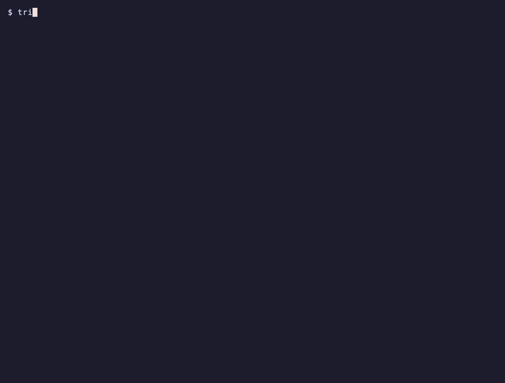

# trigger-gaps

Catch misspelled SQLite trigger event columns before shipping your database.

[](https://github.com/itzjk/trigger-gaps/actions/workflows/ci.yml)
[](LICENSE)



## Quick start

Install with Python 3.10+ and [pipx](https://pipx.pypa.io/):

```sh
pipx install git+https://github.com/itzjk/trigger-gaps.git
```

Check a consistent, standalone snapshot:

```sh
trigger-gaps check snapshot.sqlite
```

## Features

- See every declared, recognized, and absent event name, including repeated occurrences.
- Locate each name by line and column within its stored trigger SQL.
- Distinguish fully recognized lists, mixed lists, and lists with no recognized columns.
- Keep findings visible when unsupported cases make coverage incomplete.
- Feed a versioned JSON report and distinct exit codes into CI.
- Inspect schema metadata without executing trigger actions or reading business rows.

## Why

SQLite [silently ignores unknown names in `UPDATE OF` lists](https://www.sqlite.org/lang_createtrigger.html#description), so creating a trigger and passing `integrity_check` can leave an event typo undetected. The [reproduction](examples/reproduce_log.py) creates three triggers: updating `price` logs `good` and `mixed`, while `typo`, which names `prcie`, stays silent. The [alternatives comparison](docs/alternatives.md) records the tested tools and remaining uncertainty; demand for this focused check is still a hypothesis.

## How it works

The checker reads `main.sqlite_schema`, tokenizes each trigger header with source positions, and compares only its `UPDATE OF` list against `table_xinfo` metadata. Comments, string literals, and escaped double quotes are distinguished; trigger bodies are never searched for event names. Column matching folds ASCII letters only, and generated columns remain visible. A recognized name confirms existence, not updateability or that an UPDATE will fire the trigger.

## Usage

| Command or option | Purpose |
| --- | --- |
| `trigger-gaps check FILE` | Print the trigger inventory and findings |
| `--json` | Emit report schema version 1, including stored SQL and locations |
| `--max-file-bytes N` | Limit snapshot size; default 268435456 bytes |
| `--max-sql-bytes N` | Limit total schema SQL; default 1048576 bytes |
| `--timeout SECONDS` | Set a cooperative analysis deadline; default 5 seconds |
| `trigger-gaps --version` | Print the tool version |

Exit codes: **0** means complete analysis within the supported scope with no absent names; **1** means absent names; **2** means incomplete coverage, retaining any findings; **3** means an input, resource, or command error. An empty trigger inventory is reported explicitly. Neither an empty inventory nor a clean report certifies application behavior. See the [report contract](docs/report.md) for status meanings and precedence.

## FAQ

**Does this change my database?** No. It copies the input to a private temporary snapshot and opens that copy read-only, with extensions disabled. Hashes and file metadata are compared before returning a report. No repairs are offered.

**Can I check a running database?** Supply a consistent standalone copy made while writes are stopped or with SQLite's backup API. Any `-wal`, `-journal`, or `-shm` sidecar is rejected, even if empty. Detected input changes are errors; observation cannot prove a live file was stable between checks.

**Which names are supported?** Bare ASCII identifiers and double-quoted identifiers, including doubled quote escapes. Other header quoting forms produce localized omissions. [Implicit rowid aliases](https://www.sqlite.org/rowidtable.html) produce `implicit-rowid-not-analyzed`; explicitly declared columns with those names are checked normally.

**Can I reproduce the demo?** From a clone, install with `python3 -m pip install .`, generate the pair with `python3 examples/make_demo.py demo`, and check `demo/before.sqlite` and `demo/after.sqlite`. Run `python3 examples/reproduce_log.py` to observe the fixture's two-versus-three log entries separately. The checker never performs those updates.

## Limitations

- Covers persistent BEFORE/AFTER triggers on ordinary `main` tables; omitted timing uses SQLite's BEFORE default. INSERT, DELETE, and UPDATE without a list are inventoried as not applicable.
- Views, virtual/shadow tables, and unsupported headers remain visible as omissions. TEMP triggers and attached databases are outside scope.
- Does not validate bodies, WHEN expressions, business logic, or migration files. Locations refer to stored SQL, not original migrations.
- Requires SQLite 3.37+. Rejects symlink inputs and schemas exceeding 10000 objects. Resource limits apply to the whole check.

## Contributing

Run `python3 -m unittest discover -s tests -v`; include a small synthetic snapshot reproduction with changes.

## License

[MIT](LICENSE).
